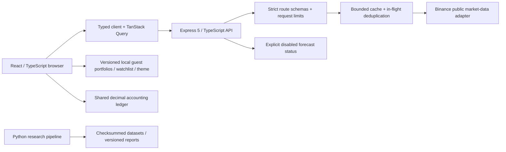

# Guest web demo architecture

`src/` contains route-level React views and reusable chart/table/status components. Pages load lazily. The typed client validates responses with shared Zod schemas and has a 15-second request budget. TanStack Query shares keys across routes/components and polls only while a resource is observed; no component sends model-specific market requests. Vite proxies `/api` to the backend in local development; Nginx does the same in Docker. Legacy `VITE_API_URL` is unused and legacy environment files are not loaded.

`shared/contracts.ts` is the asset, quote, interval and API contract registry. Eight explicitly supported USDT pairs keep provider requests/cache keys bounded. The quote is USDT, not USD; volume is exchange quote volume, not global market cap. `shared/analysis.ts` calculates descriptive SMA/Fibonacci levels from actual completed OHLCV.

`shared/portfolio.ts` validates and replays a stable chronological ledger using 40-digit decimal arithmetic. Buy fees increase weighted average cost basis. Sales remove the average cost of sold units, subtract sale fees and accumulate realized P/L. Missing open-position quotes yield null valuations, not zero prices. Every edit and delete must leave all historical balances nonnegative. Equal timestamps preserve insertion order. The browser supports up to 20 local portfolios and 5,000 transactions per portfolio; there is no simulated cash balance or external order execution. Display rounding is separate from accounting. Imported/unreadable storage is not overwritten on load.

`backend/src/app.ts` builds the read-only Express app independently of its listener, making HTTP behavior testable with injected services. `market/provider.ts` normalizes and validates provider data, ensures candle boundaries match the requested interval (including calendar months), allows at most four concurrent upstream jobs, retries transient errors once after 250 ms, and obeys global 418/429 cooldowns. The provider host is fixed and no credentials are sent. The ticker uses one batch request for eight symbols; each candle response uses at most 180 candles. There are no startup provider calls or background database scans.

`market/cache.ts` coalesces identical in-flight work, retains a bounded 256-key cache, and serves up to 15-minute-old cached results if refresh fails. Failed cold/refresh keys have a 30-second retry suppression window. Defaults: 30-second TTL, 5-second per-attempt timeout, one retry. Cold failures return a safe 503 rather than fake data. TTL/max-stale are operator configurable within validated limits.

Market metadata separates local fetch time and actual provider source time. Tickers use exchange `closeTime`; candles use the actual latest candle open boundary because the provider does not expose the forming candle's last-trade publication timestamp. Candle freshness uses cache age and whether the returned intervals cover the current time. `completed` is recomputed on cache hits. All candle boundaries are Unix milliseconds UTC; the chart library receives UTC seconds. The interface labels stale data and exposes exact candle values in an accessible table.

`predictions/service.ts` exposes a single status contract for BTC/ETH daily forecasts. Prediction/model/source values remain null while disabled. `ml/` is offline research; reports never automatically enable forecasts. There is no Redis, queue, MongoDB, microservice or extra inference server.

Deployment is a local Compose pair: a Node 24 API container running as `node`, and a static Nginx container proxying only `/api`. Only loopback web port 8080 is published. No remote infrastructure was modified. The legacy database is neither touched nor migrated.
