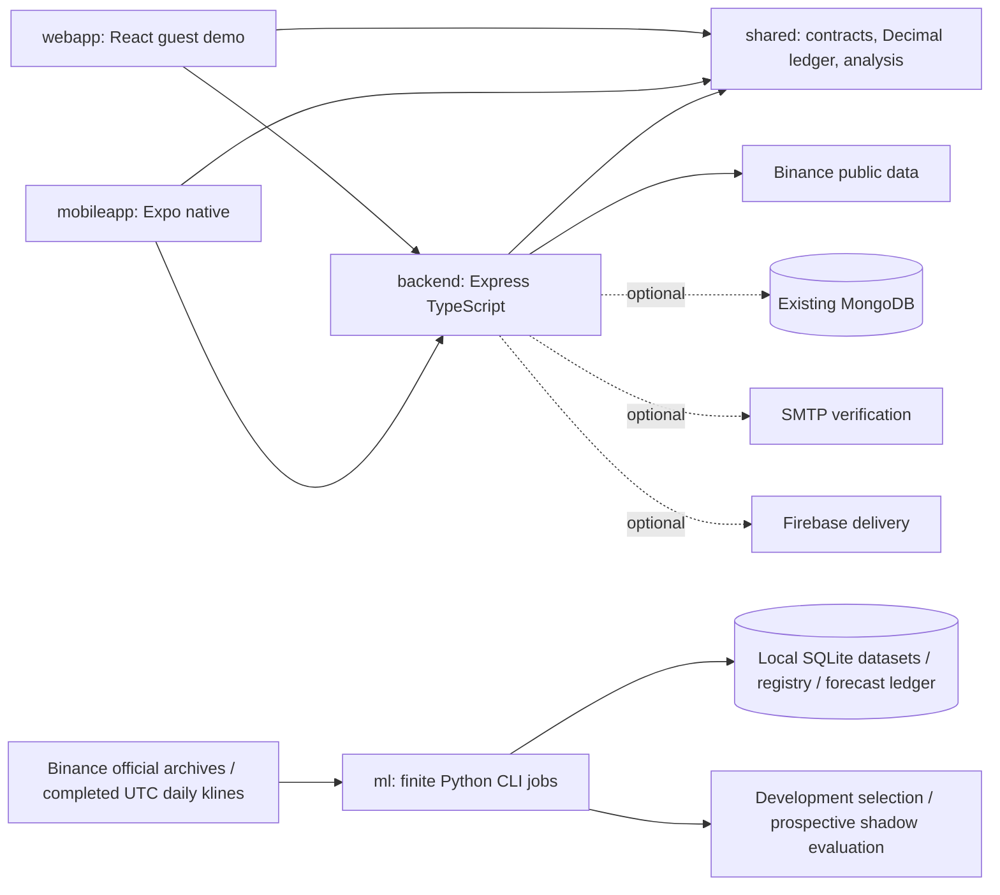

# Architecture

Investing Hub is one modular monolith with two platform-specific applications. It keeps a low-cost, database-free public composition and optional private mobile capabilities in the same API process.

## Boundaries

- `shared` depends only on Zod and Decimal. No DOM, React, AsyncStorage, filesystem or Express objects. Its pure ledger replays chronological transactions, capitalizes buy fees, deducts sell fees, preserves closed-position realized profit and refuses oversells/duplicate IDs. String inputs preserve eight-decimal precision; display conversion occurs after Decimal aggregation. Unknown valuations remain null.
- `backend/src/market` is the retained modern provider/cache/service implementation. The provider hostname is fixed, symbols/intervals allowlisted, candle UTC boundaries validated, and publication/fetch times distinguished. Cache TTL, stale limit, request deduplication, cold-failure backoff, provider concurrency/rate cooldown and request budgets bound costs.
- `backend/src/mobile` contains authenticated account, owned portfolio, settings, Mongo and notification services. Repository injection makes HTTP/service authorization and failure behavior testable without Mongo. Queries carry both owner and resource ID. Full-history validation and Mongo version predicates protect trade updates. Public routes do not read Mongo or send mail/push.
- `backend/src/app.ts` owns HTTP policy, validation and sanitized errors. `server.ts` owns environment composition and lifecycle. No active `server.js`, nested backend, ONNX runtime, generated-news provider or force-refresh endpoint remains.
- `webapp` retains its UI, Query cache and browser adapters. Guest transaction data never leaves the browser. Existing storage keys and format remain valid. It consumes shared contracts/accounting without any mobile infrastructure requirement.
- `mobileapp` owns navigation, native assets, platform APIs and secure-token/preferences adapters. One settings context replaces overlapping context requests. Its typed client validates response schemas, deduplicates only public data, and never caches a private response across sessions. Focus-aware polling ignores late responses and pauses background/hidden screens. Shared candle data feeds line/candle/analysis views.
- `ml` owns incremental completed UTC daily datasets, offline training, a transactional model registry and prospective forecast history in local SQLite. Manual and finite daily/weekly commands are independent of Express. Approval/promotion is explicit and requires prospective evidence as well as historical selection checks. Data-only numeric artifacts avoid executable model deserialization. Current publication is disabled with null predictions on both clients, including after local activation. `shared/hybrid.ts` prepares a future composition contract without LLM calls. Historical binaries/scalers remain under `ml/archive/legacy-models`, excluded from runtime contexts. See [ML boundaries and migration audit](ML_LIFECYCLE.md).

## Package/build strategy

Root npm workspaces are `shared`, `backend`, `webapp`. A single root lock resolves those packages. Mobile has its own npm manifest/lock to preserve Expo SDK 53's supported React 19.0 version without duplicating React inside the native bundle. Shared has no React dependency. Node, Vite and Metro consume the same built ESM files; TypeScript uses source type declarations. Build shared before importing it at runtime. Expo's resolver could not map Node-style relative `.js` specifiers back to source `.ts`, so native source exports were replaced by the common compiled artifact.

Root build order is shared, backend, web. Root dev starts API and Vite, while mobile starts separately. Native Gradle paths resolve from the retained mobile project with Node. EAS runs from mobileapp, uploads the monorepo context and builds shared through the post-install hook. Web Docker and API Docker use the root context and exclude mobile/ML.

## Data compatibility and operational limits

No live database was rewritten. The Mongo adapter reads existing numeric transaction fields and writes new decimals as strings in the same fields; IDs, timestamps, user ownership and collection names remain. Old unknown symbols or precision outside the domain contract return an explicit review error without rounding/deleting data. Existing invalid open-ended Infinity alerts remain in storage but cannot deliver. Unsupported favorites remain readable.

The default is a single API process. Verification codes and request limits are in-memory. Guest state is local to its browser; mobile has private remote portfolios and local guest preferences. There is no automatic merging of guest and private ledgers, no trading execution, and no distributed background service. Alerts are best effort. SMTP/FCM and production account infrastructure require operator configuration. See SECURITY and VERIFICATION for actual checks and remaining limitations.
