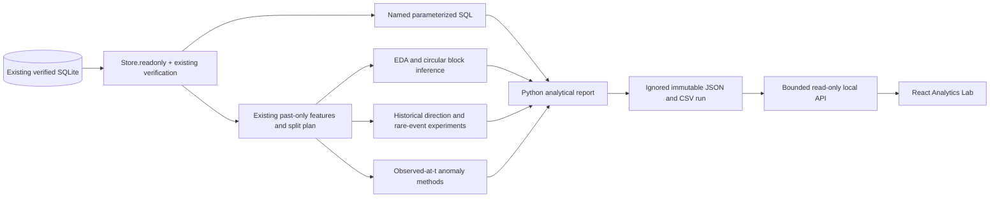

# Analytics Lab: applied data analytics and ML engineering

Analytics Lab is a **local, non-commercial research workspace**, separate from Future Analysis. It answers what the verified data contains, how statistical methods behave, how classifiers compare with simple references, and where evidence is missing. It never approves a model, creates prospective observations, changes recorded forecasts or calls Gemini.

## 1. Audit and architecture

The starting implementation already provided verified Binance ingestion, immutable SQLite data/provenance, fourteen past-only features, independent regression candidates, purged chronological evaluation, prospective reconciliation, a registry, interval calibration and strict publication gates. Future Analysis already combined approved numeric evidence with an opt-in, budgeted Gemini critical review. Those features remain intact.

| Capability                               | Starting state                            | Extension                                                                                              |
| ---------------------------------------- | ----------------------------------------- | ------------------------------------------------------------------------------------------------------ |
| Data quality and feature extraction      | Implemented in `store.py` / `features.py` | Reused unchanged; dedicated `Store.readonly()` avoids schema creation                                  |
| Regression and interval evaluation       | Implemented, no locally approved models   | Read existing frozen evidence; separate historical selection, prospective shadow and active monitoring |
| Chronological splits                     | Implemented in regression                 | Extracted `evaluation_splits()` and reused it with `training_slice()`                                  |
| EDA, statistical inference, correlations | Partial manual six-month study            | Reproducible distributions, statistics, calendar-aligned rolling correlations and block inference      |
| Trained direction/rare-event classifiers | Missing                                   | Independent research workflow, baselines, weighted candidates and validation-only thresholds           |
| Unsupervised anomalies                   | Missing                                   | Four causal-at-observation methods; no invented supervised accuracy                                    |
| SQL, analytical export and Lab UI        | Missing                                   | Named read-only queries, immutable local runs, CSVs, bounded contracts and separate web navigation     |

The standalone, untracked `ml/experiments/six_month_study.py` was subsequently reviewed and removed at the owner's request. Its return/volatility calculations duplicated existing features and Analytics Lab, bypassed source/completion verification and could join returns across missing days. Use the verified analytics command and existing feature extractor instead of maintaining a second script.



Python owns computation/training. Express only verifies a bounded file and its source database stamp. React renders deterministic results through a shared Zod contract. Classifiers have research version hashes, not another production model registry. No classifier artifact, approval flag or inference endpoint is introduced.

## 2. Run locally

Use the existing Python 3.13 environment and pinned `ml/requirements.txt`; SciPy, NumPy, pandas and sklearn were already installed. No dependency was added.

```powershell
# Root checkout; existing verified database required. No data download occurs.
.\.venv\Scripts\python.exe ml/pipeline.py analytics --db ml/data/lifecycle.sqlite3
```

The default output is ignored `ml/data/analytics`. A complete run creates `runs/<run-id>/report.json`, six CSVs and `columns.json`, then atomically replaces `latest.json`. Run directories are created exclusively and never overwritten. An interrupted run cannot replace the latest complete report. Retain incomplete directories for inspection; cleanup is an operator action. A missing database is refused rather than created. `--output <directory>` and `--db <path>` support explicit local locations; no scheduler is installed.

For a configured API, use an ignored private env file based on `backend/.env.example`:

```text
ANALYTICS_LAB_ENABLED=true
# Set both absolute paths only when using a custom location:
# ANALYTICS_EXPORT_PATH=C:\private\analytics\latest.json
# FUTURE_ML_DATABASE_PATH=C:\private\ml\lifecycle.sqlite3
```

Run `npm run build -w shared`, then `node --env-file=backend/.env.local --import tsx backend/src/server.ts`; start Vite separately with `npm run dev:web`. Open `http://127.0.0.1:3000/analytics`. Node reads only the selected process environment; a normal `npm run dev` does not implicitly load `.env.local`.

The endpoint `GET /api/analytics/:symbol` requires the enable flag, non-production mode, a loopback socket address, a loopback Host and, when present, a loopback browser Origin. Forwarding headers do not grant access. **Production always returns disabled**, even with the flag set. No CSV/raw-data/model-artifact HTTP endpoint exists. The web navigation remains visible with an honest disabled state. This gate is deliberately independent of Gemini flags.

The existing `FUTURE_ML_DATABASE_PATH` identifies the same source registry; changing it also affects Future Analysis, so keep both features on the intended database. A read transaction keeps the research snapshot consistent and can delay offline SQLite writers; run analytics when lifecycle jobs are idle. Normal market and Mongo portfolio requests do not use this transaction. Keep SQLite outside OneDrive/network sync for regular operation. WAL mode is refused because file-stamp validation assumes the lifecycle's rollback journal.

## 3. Data quality and exploratory statistics

`Store.verified_frame()` verifies dataset/source hashes and metadata, UTC daily completion, positive finite prices, valid OHLC ranges and source provenance. Existing anomaly-review safeguards remain unchanged: moves above the lifecycle's absolute-return integrity threshold require manual source review. Statistical outliers **inside verified data are retained**, never clipped or deleted.

Returns use `close[t]/close[t-1]-1`, only inside contiguous segments. Gaps start new windows; prices are never filled. Coverage, missing days and stale last-completed-candle status remain separate. A stale but verified history is valid for explicitly dated exploration; it is not a current approved forecast. At most 6,000 observations per asset are accepted by this release.

The report contains sample mean/median, sample variance/std (`ddof=1`), 5/25/75/95 percentiles, bias-corrected skewness and Fisher excess kurtosis. Undefined small/constant-sample quantities are null. Histogram counts account for all observed returns. Rolling volatility uses fourteen daily returns. The last 180 calendar days are sampled every seven days for lightweight charts; values remain daily quantities, not weekly compounded returns. Missing calendar samples remain gaps in the plots.

Contemporaneous return/log-volume-change Spearman correlation is descriptive association. Thirty-day cross-asset Pearson correlations require thirty aligned, non-missing calendar observations; missing periods produce null rather than forward filling. Return and absolute-return lag-one autocorrelations expose possible serial dependence, without claiming to prove independence or stationarity.

## 4. Hypotheses and dependence-aware inference

The window policy is declared in `analytics/report.py`: two adjacent 180-day calendar periods anchored to the latest verified source close, without selecting peaks or favorable market events. Both require complete contiguous returns. Two primary null hypotheses per available asset are:

1. Equal mean daily returns between periods A and B.
2. Equal mean absolute returns, used explicitly as a volatility proxy rather than a variance or full-distribution test.

Effects are B minus A. Seeded **circular block bootstrap** preserves short-range temporal dependence within each period. Blocks have length 14, 999 resamples; fixed 7/28-day block sensitivity intervals are shown without choosing the most favorable length. Wrapping is a resampling device, not a new market observation. The basic 95% interval uses centered bootstrap errors; the approximate two-sided p-value counts centered errors at least as extreme as the observed effect, with the finite-resample `+1` correction.

Holm step-down correction covers every available primary asset/hypothesis result in the run. Unavailable assets are reported rather than silently replaced; the report records family size. Pointwise confidence intervals are not simultaneous intervals. Sensitivity intervals are descriptive robustness checks, not additional significance claims.

These procedures assume approximately stationary, short-memory behavior within each window. Crypto volatility clustering, long memory and structural breaks can violate those assumptions. Autocorrelation diagnostics and block sensitivity do not guarantee validity; a small p-value establishes neither causality nor investment value. Ordinary iid SciPy bootstrap or label-shuffling permutation tests would not solve temporal dependence. See [SciPy bootstrap](https://docs.scipy.org/doc/scipy/reference/generated/scipy.stats.bootstrap.html), [permutation assumptions](https://docs.scipy.org/doc/scipy/reference/generated/scipy.stats.permutation_test.html), [time-series block guidance](https://arch.readthedocs.io/en/latest/bootstrap/timeseries-bootstraps.html) and [Holm's step-down implementation](https://www.statsmodels.org/stable/_modules/statsmodels/stats/multitest.html).

## 5. Supervised direction and imbalanced experiments

Features come from the full verified history before any display-range restriction. This preserves warmup data; passing only six months to the existing `prepare()` would fail its 500-sample safeguard. The Lab uses the same past-only feature extractor, requires at least 500 labeled rows and withholds classifier evaluation for gapped history.

Three outer chronological folds use the existing splitter/purge policy, sixty evaluation days per fold and an unused origin between blocks. `training_slice()` requires every training target before the first evaluation source time. The final sixty training origins form threshold validation; core fitting labels finish before that validation starts. Scaling is fitted only on core training. Fits remain frozen after threshold validation, with no refit on validation data. All evaluation periods remain **historical development research**, not newly untouched or prospective evidence.

Direction labels are next-day positive return versus non-positive return. References are majority-class prior probabilities and the current observed return's direction. Candidates are StandardScaler + Logistic Regression, Random Forest Classifier and Gradient Boosting Classifier. Fixed seed, bounded depths and one-worker forest fitting make comparisons reproducible in the recorded environment. Regression sign accuracy remains separate.

The rare event is absolute next-day return strictly above the **core-training-only 95th percentile**, frozen independently for each fold. It is not redefined with validation/evaluation outcomes. Compare majority/naive references, unweighted logistic/forest and class-weighted logistic/forest. Tune candidate decision thresholds on the later validation block using a fixed 0.1–0.9 grid and positive-class F1; ties select the higher threshold. Single-class validation defaults explicitly to 0.5. No synthetic oversampling is used: it is unnecessary here and could manufacture unrealistic temporal observations.

Every fold records prevalence, train/validation/evaluation dates, decision and event-magnitude thresholds, model/data/code/config versions, confusion `[TN,FP,FN,TP]`, accuracy, balanced accuracy, precision, recall, F1, ROC-AUC, average precision, Brier and false-positive rate. **AP is average precision, not trapezoidal PR-AUC.** Single-class training withholds candidates; single-class evaluation makes balanced accuracy/ROC-AUC/AP unavailable. Zero positive predictions yield zero precision/recall/F1 under an explicit reporting convention. Scores are uncalibrated; reporting Brier evaluates probability error, without claiming calibrated confidence. See [sklearn leakage guidance](https://scikit-learn.org/1.7/common_pitfalls.html), [chronological splits](https://scikit-learn.org/1.7/modules/generated/sklearn.model_selection.TimeSeriesSplit.html), [class weights](https://scikit-learn.org/1.7/modules/generated/sklearn.linear_model.LogisticRegression.html), and [AP](https://scikit-learn.org/1.7/modules/generated/sklearn.metrics.average_precision_score.html).

Accuracy alone can look excellent when a period contains no extreme events. Preserve such negative/insufficient results. A threshold learned from a long volatile training period can produce no rare events in calmer evaluation periods; that is evidence about label/regime mismatch, not a reason to tune against already inspected outcomes. Test a revised policy as a new, prespecified research version with future data before considering usefulness.

## 6. Observed anomalies and explanations

All methods score observations **at t** and fit their references using earlier data only, separately within contiguous segments:

| Method           | Historical reference and trigger                                                                   | Monitoring priority                              |
| ---------------- | -------------------------------------------------------------------------------------------------- | ------------------------------------------------ |
| Rolling Z        | Earlier 60 observations, at least 30; absolute standardized score >3                               | High at twice trigger                            |
| Rolling IQR      | Earlier 90 observations, at least 30; >1.5 IQR beyond quartiles                                    | High at twice trigger                            |
| Robust MAD       | Earlier 90 observations, at least 30; >6 scaled MAD from median                                    | High at twice trigger                            |
| Isolation Forest | Monthly refit after 180 observations, at most 365 earlier feature rows, training contamination .02 | Positive `-decision_function` triggers; >.1 high |

Inputs include return, log-volume change, fourteen-day volatility and intraday range. Statistical events identify the strongest triggering indicator. Events include date, score, method threshold, reference boundaries and severity. Constant-scale reference windows are unscored rather than divided by zero. An observation may trigger several methods; counts are method alerts, not unique fraudulent days. Frequency uses eligible observations as its denominator. No anomaly labels exist, so unsupervised precision/recall/F1 are not fabricated. Scores are neither event probabilities nor evidence of manipulation.

## 7. Existing regression, monitoring and intervals

The comparison reads frozen registry versions and their dataset/feature hashes, training ranges, selection dates, samples, MAE/RMSE in return fractions and USDT price units, no-change baselines and fold consistency. It does not retrain those models. A historical failure remains visible.

Prospective observations must pass both parameterized SQL chronology checks and the canonical `forward_rows()` filter. Candidate-origin shadows and active-origin forecasts remain separately labeled. Residual distributions, baseline comparisons and high/lower-volatility regime errors use genuine evaluated ledger rows only. Regimes compare source-time volatility with a median of earlier observations; they are descriptive, not causal labels. Recent/prior thirty-observation MSE comparisons stay separated by model and origin phase; fewer than ten observations per side is insufficient for even a descriptive deterioration assessment.

Historical interval metadata comes from the existing development-OOS calibration and later selection evaluation. Monitoring coverage and relative width use only originally stored bounds against subsequently observed outcomes. Missing calibration or outcomes is unavailable, never zero error/coverage. Empirical coverage is not a guaranteed future probability. The Lab never repairs old candidates with made-up calibration, reconciles pending forecasts or weakens publication rules.

## 8. SQL analytics

`ml/analytics/queries.sql` contains named, bounded, parameterized queries. `analytics/sql.py` executes them through the existing read-only Store connection. The Lab creates no tables/indexes and copies no candles into another database.

| Query                | Analytical question / technique                                                             |
| -------------------- | ------------------------------------------------------------------------------------------- |
| `observations`       | Consecutive returns and missing-day inspection using `LAG`, bounded 6,000 rows              |
| `assets`             | Coverage and model counts using CTEs, `GROUP BY` and `LEFT JOIN`                            |
| `versions`           | Frozen versions and existing evaluation metadata, bounded 100                               |
| `evaluated`          | Prediction/actual outcomes joined with model chronology, bounded 5,000                      |
| `latest_performance` | Latest cumulative snapshot using `ROW_NUMBER`; never sum cumulative snapshots               |
| `deterioration`      | Recent/prior errors using phase-specific windows over canonically verified prospective rows |
| `anomaly_frequency`  | Method/month aggregation over transient derived event JSON using `json_each` and `GROUP BY` |

Existing candle primary keys and prediction unique keys start with symbol; model/performance joins use primary keys. They support this bounded local dataset without speculative schema changes. Profile larger workloads with `EXPLAIN QUERY PLAN` before adding indexes through separately reviewed lifecycle maintenance; the analytics command itself is read-only. Limits define this release's research scope; very large histories need a reviewed extension rather than silently widening API payloads.

Example Python session (run with `PYTHONPATH=ml`, or from `ml`):

```python
from store import Store
from analytics.sql import query

store = Store.readonly('data/lifecycle.sqlite3')
try:
    coverage = query(store, 'assets')
    observations = query(store, 'observations', symbol='BTCUSDT')
    print(coverage)
finally:
    store.close()
```

## 9. Excel and Power BI

CSV exports are offline-only. UTF-8 BOM supports Excel; ISO dates use UTC, ledger epoch fields use Unix milliseconds, returns use fractions and prices use USDT. Strings beginning with spreadsheet formula markers are escaped; numeric negative returns remain numbers. Every table includes run ID, generation time, schema/feature version and code hash. `columns.json` records fields and units inside the same checksum envelope as JSON reports.

- `descriptive_statistics.csv`: asset, dataset fingerprint, metric, value and unit.
- `classification_comparison.csv`: one task/model/fold result, time boundaries, prevalence, thresholds and metrics.
- `regression_comparison.csv`: existing registered historical selection metrics, baseline and fold wins.
- `evaluated_predictions.csv`: genuine observed ledger outcomes and phase; can legitimately have headers only.
- `anomalies.csv`: all local derived event rows with reference dates, method, trigger and priority.
- `anomaly_summary.csv`: asset/month/method alert counts. The dashboard retains only the latest 200 event details per asset; CSV retains all events from the bounded run.

Useful Excel PivotTables: model/fold versus balanced accuracy and AP; asset/method/month versus alert count; registry model versus RMSE and baseline; outcome phase versus prospective sample count. Filter out blank/undefined metrics rather than treating them as zero. For a structured classification table, conditional research review can use:

```excel
=IF([@positives]<5,"Insufficient positives",IF([@recall]<0.5,"Review missed events","Inspect trade-off"))
```

This is an exercise threshold, not a trading/operational loss decision. Do not average confusion rates across unequal folds without reporting weights; aggregate confusion counts first, then recompute rates where targets/definitions are comparable. Rare-event magnitude thresholds vary by fold and must remain visible.

Power Query example for an immutable run CSV:

```powerquery
let
    Source = Csv.Document(File.Contents("C:\private\analytics\runs\RUN_ID\classification_comparison.csv"),
        [Delimiter=",", Encoding=65001, QuoteStyle=QuoteStyle.Csv]),
    Headers = Table.PromoteHeaders(Source, [PromoteAllScalars=true]),
    Typed = Table.TransformColumnTypes(Headers,
        {{"samples", Int64.Type}, {"positives", Int64.Type}, {"balancedAccuracy", type number},
         {"averagePrecision", type number}, {"evaluationStart", type datetimezone}})
in Typed
```

Keep nulls as nulls, and use separate task/model/fold dimensions. Example DAX:

```dax
Positive prevalence = DIVIDE(SUM(Classification[positives]), SUM(Classification[samples]))
Alert count = COUNTROWS(Anomalies)
```

Select a single model/fold before interpreting prevalence so repeated experiments do not duplicate observations. Prefer a date dimension joined to observed event date for monthly alert charts, separate from forecast target dates. Build a confusion heatmap, prevalence-versus-recall view, model-versus-baseline table and observed-alert calendar. A saved Power BI connection must remain local/private unless redistribution rights are separately established.

## 10. Reproducibility, licensing and limitations

Runs record dataset/code/config hashes, registry size/mtime, feature version, fixed seeds and Python/NumPy/pandas/SciPy/sklearn versions. Model research versions include task, algorithm, fold, config, code and dataset identity. Source-file bytes and numeric environment matter; cross-platform BLAS/line-ending changes may affect hashes or numeric reproducibility. Deterministic fixture tests verify repeatability and isolation of earlier outputs from changed later data.

The backend accepts a bounded checksum envelope, validates all eight assets and semantic counts/chronology, then verifies database stamps before/after reading. A changed database revokes the export; rerun analytics. Reports older than one day or with stale source data are labeled stale; after seven days they are withheld. Checksums detect corruption, not forgery by an operator controlling both files. No raw candles, sources, SQL inputs, model binaries or credentials are returned.

The [Binance Vision Dataset Terms](https://github.com/binance/binance-public-data/blob/master/TERMS_AND_CONDITIONS.md), reviewed 2026-11-07, cover derived analytical indicators as well as datasets, specify CC BY-NC-SA 4.0 and require a separate written commercial license. Source-code licensing does not establish data redistribution rights. Runtime data/reports/CSVs remain ignored and the dashboard stays local/development-only; no hosted analytics feed or deployment is introduced. Attribute Binance Vision and review applicable share-alike requirements before distributing derived research. No commercial authorization is claimed.

This release is a bounded research tool, not monitoring automation: no scheduled refresh, externally validated anomaly labels, calibrated classifier probabilities, prospective classifier ledger, significance claim for model comparisons, production classifier approval or alert delivery. Source/data gaps, nonstationarity, small rare-event counts, multiple model comparisons and changing market regimes limit interpretation. Negative results remain first-class outcomes. See [actual verification](DATA_ANALYTICS_VERIFICATION.md).

## 11. Transfer to electricity distribution analytics

The transferable engineering skills are verified time-indexed data, SQL joins/windows, train-only transforms, chronological validation, imbalanced evaluation, transparent anomaly references and human review priorities. For consumption data, add meter/feeder identifiers, time zones/DST, settlement intervals, weather, holidays, outages and sensor-quality flags. Separate a physical engineering model of technical losses from labels for verified non-technical loss investigations.

Crypto market anomalies **are not electricity theft or technical loss observations**. Reuse methods only after obtaining domain data and validated outcomes. Prevent meter/feeder leakage across training and evaluation; respect when investigation labels actually became available. Evaluate precision/recall and review cost by customer/feeder groups, monitor false positives, and include engineering experts before operational decisions. An unsupervised score alone cannot establish theft, causality or loss probability.

## 12. Practical exercises

1. Run analytics twice with unchanged verified data. Compare scientific metrics and version/config/data hashes; explain why run ID/time differ. Confirm SQLite bytes and model/forecast counts are unchanged.
2. Inspect the two prespecified hypothesis windows and autocorrelation. Compare 7/14/28-day intervals. Explain why a pointwise interval and Holm-adjusted p-value answer different multiplicity questions.
3. Compare direction candidates with majority/naive references in every fold. Compute accuracy manually from confusion counts. Explain why a selected best historical score is not proof of future usefulness.
4. Inspect rare-event prevalence and frozen magnitude thresholds. When an evaluation window has no positives, explain the null ROC-AUC/AP and why high accuracy is uninformative. Propose a new threshold policy before collecting its future evaluation data.
5. Compare Z/IQR/MAD/Isolation Forest dates. Identify alerts due to volume versus returns; do not remove them from the source data or label them fraud. Explain each reference boundary and monitoring priority.
6. Use `observations` and `anomaly_frequency` SQL, build an Excel PivotTable and Power BI report, and preserve units, nulls and run identity. Keep outputs private/local.
7. Read the existing prospective ledger: pending is not evaluated. Explain why residuals/coverage cannot exist until outcomes are observed, and why analytics cannot approve a model.
8. Design a separate electricity-consumption study with known labels, label-availability times, meter-group separation and a documented false-positive investigation budget. State which crypto conclusions cannot transfer.
