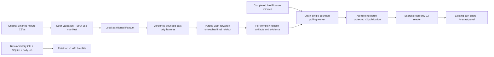

# Historical multi-horizon migration

Status: feature branch; no merge, deployment or production-data mutation authorized.

## Audit and dependency map

The audit covered tracked file inventory, workspace manifests, shared contracts/clients,
Express composition, public market provider/cache, private account/portfolio/email
boundaries, web routes/chart/localization, Expo consumers, Python lifecycle modules,
archived models, SQLite lifecycle, Docker contexts, Railway supervisor and CI/tests.

Current dependencies: `ml/provider.py`, `ingestion.py`, `store.py` verify daily
data in existing SQLite. `features.py`, `train.py`, `lstm.py`, `selection.py`
fit/select per coin. `artifact.py`, `lstm_inference.py`, `forecast.py` run frozen
models and append immutable forecasts. `publication.py` publishes v1 stamped
against SQLite; `backend/src/predictions/service.ts` reads it. `daily.py`,
`run.ps1`, opt-in `schedule.ps1` and Railway `runtime.py` schedule finite jobs.
Web `PricePredictions` and Expo `PredictionStatus` consume v1. Market chart,
authentication, portfolio, email and Mongo services are independent of fitting.

## Migration order and safety gates

A. Document architecture and budgets; create dedicated feature branch.
B. Validate original files without mutation, reject gaps instead of filling,
   fingerprint each input, publish a manifest only for a complete validated run.
C. Share one finite-window feature pipeline between historical and live inputs;
   target log returns at exact completed-candle times.
D. Compare all seven families on identical origins with train-only scaling,
   horizon purging and a final chronological holdout. Fix configurations before
   looking at holdout. Record reduced-budget scope, failures and timings.
E. Freeze deterministic validation-only selection; require meaningful improvement
   and stability against no-change. Unconvincing pairs remain unavailable.
F. Add explicit offline/worker command surface, separate artifact registry and
   v2 publication. Never train from HTTP or change existing SQLite.
G. Add strict v2 API and localized panel inside the existing market experience.
   Preserve daily API/mobile; bookmarked prediction URLs get a migration path.
H. Remove only proven superseded tracked UI after replacement tests. Keep daily
   runtime and all historical models/data until full replacement validation.
I. Execute regression/build/integration checks, record unexecuted checks, commit
   phases separately, push feature branch and open PR without merge/deployment.

## Resource budget and statistical limits

Default benchmark: one symbol/horizon at a time, one numerical thread, fixed seed,
bounded training sample count and tree/epoch counts, no hyperparameter sweep.
Minute-resolution labels remain minute-resolution even when fitting origins are
sampled to meet the CPU budget. All candidates see identical sampled fit origins
and identical validation/test timestamps. Reports disclose the sampling budget.
Live polling uses a bounded window, completed candles only, one request per coin
per minute and a frozen artifact cache; no permanent Python HTTP server, Redis,
Kafka or Celery. Training dependencies/data stay outside production images.

Twelve months have at most twelve independent non-overlapping monthly outcomes.
`1M` is unavailable. A future monthly study needs multiple years spanning distinct
regimes, pre-registered monthly folds and a separate multi-year holdout; adequacy
must be justified by effective sample size and uncertainty, not a row-count gate.
`1m` and `1M` are case-sensitive, independent of chart sampling intervals.

No forecast can be called reliable from directional accuracy alone. Selection is
not trading-profit certification. Costs/slippage are explicit diagnostics only.

## Rollback

Leave minute worker disabled and remove its v2 publication configuration. v1
SQLite, daily job, endpoints and native consumers remain usable. No migration
rewrites any existing database. No ignored data or historical evidence is deleted.
