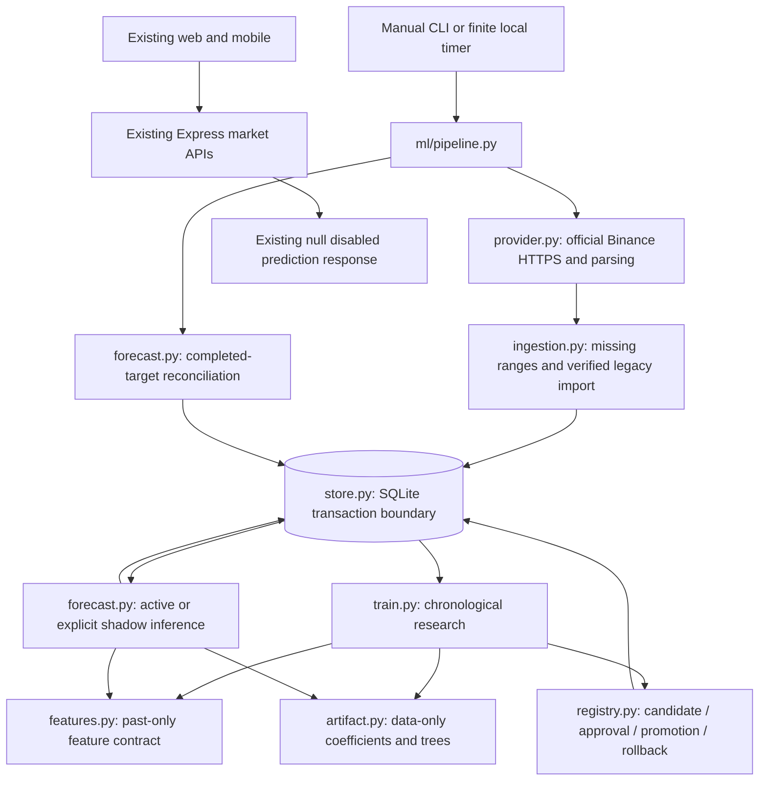

# ML lifecycle architecture and migration audit

Original lifecycle audit on `main`, now extended by [Future Analysis](FUTURE_ANALYSIS.md) with all shared assets, chronological residual intervals and explicit gated publication. The historical implementation findings below are preserved; no deployment or automatic approval is introduced. The full workflow is in [ml/README.md](../ml/README.md).

## Audit of the starting implementation

| Area                                 | Reused contract or behavior                                                                            | Weakness addressed / migration risk                                                                                                                                                                                                 |
| ------------------------------------ | ------------------------------------------------------------------------------------------------------ | ----------------------------------------------------------------------------------------------------------------------------------------------------------------------------------------------------------------------------------- |
| `ml/download.py`                     | Official Binance spot archives, SHA-256 sidecars, millisecond normalization, CSV provenance            | Fixed 2021-2025 range; rewrote CSVs and manifest directly; partial failure could publish mismatched files; no incremental repair/completion checks. Replaced with CLI sync.                                                         |
| `ml/features.py`                     | Fourteen past-only daily features, exact next-day return target, gap segmentation                      | Kept shared train/inference logic. Added explicit integer/unit validation, injected UTC clock, true completion at next midnight and missing-day counts. Legacy feature order retained; contract bumped to v2.                       |
| `ml/train.py`                        | Ridge pipeline/scaling, Random Forest/Gradient Boosting, fixed seed/single worker, RMSE/MAE/direction  | Repeated final-test opening after tuning undermines independence. No registry or incumbent comparison, full-history fit only. Replaced with chronological development/selection, four history windows, prospective promotion gates. |
| `ml/predict.py`                      | Latest complete feature row, return-to-price conversion                                                | Arbitrary `--artifact` joblib deserialization, no status/recency gates, no persistent forecasts. Replaced by registry-only numeric inference and a forecast ledger. Old flags now fail explicitly.                                  |
| `ml/config.json`                     | Two supported pairs, seed, conservative baseline improvement and anomaly threshold                     | Removed static end month/fraction split. Added history start, frozen development cutoff, rolling/expanding policies, fold sizes, evidence minimums and expiry.                                                                      |
| `ml/reports/`                        | Earlier text/JSON results and provenance remain historical evidence                                    | Preserve original metrics; label them as inspected development evidence. Never rewrite them with a supposed untouched 2026 test. New registry reports live with each candidate.                                                     |
| Existing Python tests                | Feature future-isolation, exact target, gaps, invalid OHLCV, UTC completion, latest inference features | Retained and extended with integration tests of provider/storage/training/registry/forecast behavior. Synthetic fixtures are test-only.                                                                                             |
| `shared/`                            | Pure platform-independent financial contracts/Decimal ledger and typed clients                         | No financial-domain rewrite. One strict Future Analysis contract/export with separate tests; existing prediction schema remains disabled.                                                                                           |
| `backend/src/market/`                | Existing public provider, allowlisted symbols/intervals, cache, budgets, TTL/stale/error handling      | Retained. It serves bounded UI requests rather than durable ML history; Python acquisition is separate because its lifecycle/archive/completion guarantees differ. No Express-to-training coupling.                                 |
| `backend/src/predictions/service.ts` | Explicit `disabled_unvalidated`, null model/source/value                                               | Unchanged. The legacy response stays disabled. Future Analysis is a separate explicit publication boundary.                                                                                                                         |
| Web/mobile/docs                      | Existing demo, private services, runtime/Docker boundaries                                             | Application logic untouched. Local research operations and their new limitations are documented separately.                                                                                                                         |

No verified CSVs or current fitted artifacts existed in this checkout at audit time. Import is implemented for owners with those ignored files elsewhere. Legacy model binaries are quarantined and never loaded or migrated.

## Components and ownership

Provider-specific logic does not know about SQLite or sklearn. Ingestion owns requested coverage, validation and source attribution. Features remain provider/storage independent. Training fits candidates and records evidence; registry owns status transitions. Offline inference and reconciliation own the prospective ledger. The CLI composes finite commands and records failures. The PowerShell runner adds logs and a local per-database mutex, without registering scheduled jobs.

SQLite's rollback journal, `synchronous=FULL`, foreign keys, explicit `BEGIN IMMEDIATE` transactions and unique keys provide one-writer serialization. Sync holds a transaction across one symbol's downloads to prevent competing stale upserts; a large initial sync can block other commands. The scheduler should avoid overlaps; competing CLI writers fail after a bounded 30-second lock timeout. This is appropriate for two daily pairs and weekly CPU fits. Concurrent distributed workers/network filesystems are deliberately unsupported.

## Persistent contracts

| Table              | Contents / invariants                                                                                                                                                                    |
| ------------------ | ---------------------------------------------------------------------------------------------------------------------------------------------------------------------------------------- |
| `sources`          | Content-addressed metadata: retrieval time, URL, response hash, archive publisher hash when available and license reference. Symbol and retrieval fields cross-checked against metadata. |
| `candles`          | `(symbol, open_time)` key, normalized UTC millisecond OHLCV and first verified source ID. Identical rows reused; conflicting records rejected. No price filling.                         |
| `datasets`         | Current symbol fingerprint, range/count, version creation time, parent version and source manifest. Recomputed on read.                                                                  |
| `dataset_versions` | Append-only metadata for each verified normalized dataset state. Historical subsets remain reconstructible from immutable rows and source IDs.                                           |
| `models`           | Immutable candidate report and numeric artifact/checksum, explicit mutable status; unique active model per symbol.                                                                       |
| `predictions`      | Unique model/symbol/target, origin and exact future target, original values, reconciliation actual/error/status and provenance details. Original predictions remain unchanged.           |
| `performance`      | Cumulative forward model/baseline metrics through each observed target; idempotent reconciliation refreshes the same target snapshot.                                                    |
| `events`           | Training, sync, approval, promotion, rollback, rejected/disabled/failed forecasts, evaluations and failed commands.                                                                      |

The fingerprint hashes canonical normalized numeric rows, not original CSV formatting. Dataset versions and model reports preserve exact source IDs and configuration. Old archive bodies are not cached. REST checksums are locally calculated acquisition digests rather than publisher attestations. SQLite/database permissions are a local trust boundary: checksums are integrity checks, not signatures against a malicious owner editing both values and hashes.

Legacy import checks the old CSV SHA-256 against its manifest, carries forward archive metadata, validates candles and records a new import source without altering original files. If the owner does not trust the legacy manifest, sync to a separate empty database instead. Historical source revisions require explicit review/migration in a separate database; silently changing evaluation actuals is prohibited by the immutable-row policy.

## Temporal evaluation contract

1. An observation is available only after `open_time + 86400000 <= now`. Last source close is yesterday's final UTC millisecond. Future or forming candles never enter training.
2. All features at close `t` use observations through `t`; the target is close `t+1`. No transform fits against validation data.
3. Historical evaluation uses a fixed, already-inspected development domain ending before 2027. Each fold purges training labels with `target_time >= first_evaluation_source_time`; unused origins separate evaluation blocks. Recent windows roll or expand with documented anchors; full history expands.
4. The first three default folds support development consistency; the fourth is the selection period. Algorithms and window policies can be compared there. This is not a genuinely untouched final test, including for 2026.
5. Final candidates fit currently available completed labels and freeze their numeric artifact/ID. Repeating the exact same dataset/config/code/environment reuses the registered version rather than overwriting it.
6. A prospective forecast records real generation time, source close and the following day's exact target close. The CLI exposes no backdating flag. It refuses stale/gapped sources, expired models, feature mismatches, data retrieved after origin, models trained in the future and training labels after source close.
7. Reconciliation observes the actual target only after its day completes and that observation is ingested. Duplicate runs cannot create a second forecast or revise the original price/return.
8. Promotion requires historical baseline consistency plus at least 30 prospective forecasts and 2% return-RMSE improvement over zero return. Against an incumbent it additionally compares at least 30 shared target dates. Failures/pending evidence preserve the incumbent. Approval and promotion are explicit; no training/scheduler/API path promotes automatically.
9. Shadow evidence used to approve a model is prospective validation; later active forecasts are the continuing forward evaluation. Repeated tuning or many-candidate selection introduces selection bias. No significance, calibrated uncertainty or tradable profitability is asserted.

These rules separate historical development, model selection and new outcomes without relabeling already inspected data as an untouched holdout. Default expiry (90 days) requires continued candidate work and review; weekly candidates may need to remain in shadow longer than a month. Failing historical gates does not erase a model; explicit rejection retains its record.

## Security and operations

Only Binance's documented HTTPS archive and market-data hosts are accepted, with redirects refused. Downloads are bounded to 8 MiB, ZIP members are allowlisted and parsed without extraction, and provider errors have finite retries/timeouts. A missing archive alone permits documented REST fallback. Restrictions/rate limits never invoke synthetic or third-party market data. Existing verified rows survive corruption/outages.

Numeric artifacts contain only supported coefficient/scaler/tree arrays. Bounded sizes, finite values, ordered child indices, feature/version checks and SHA-256 precede numeric interpretation. No arbitrary Python imports, pickle/joblib loading or downloaded ONNX execution occurs. Exported prediction parity is checked against sklearn. Keep local DB ownership/access restricted; an attacker who controls the registry can falsify numeric data even without executing artifact code.

Promotion atomically archives the incumbent and activates the approved candidate. A failed statement rolls the entire transition back. Rollback requires a prior activation event, archived status, intact artifact/feature contract, acceptable age and an operator reason. It can restore an older approved model despite a recent score regression, but cannot resurrect an expired/corrupted/never-approved artifact. The legacy prediction API remains disabled; the Future Analysis export separately rechecks all publication gates.

Run on persistent local disk, outside OneDrive/network shares. Take a SQLite online backup using the CLI, stop all jobs before replacing/restoring a DB, retain the original backup and run `validate`/`status`. There is no automatic cleanup of history or data correction. Schema `user_version=1` is explicit; unknown versions are refused rather than silently migrated. Timers/log rotation/backups/alerts/clock synchronization are operator-owned. The system recovers missed market observations after downtime, but missed forecasts remain missed.

## Future Analysis boundary

`shared/future-analysis.ts` is the active composition contract. Python exports only current approved active-origin ledger forecasts with historical/prospective gate evidence and empirically evaluated chronological residual intervals. Calibration is fitted on development-fold OOS residuals before the selection fold; it never uses in-sample final-fit residuals. The checksum/stamped publication remains valid only while the same registry file is unchanged. Gemini receives this evidence and can challenge its interpretation using current grounded research, without numerical overrides. The backend checks identity, timing, policy/metrics, units, parity, source metadata and review fingerprint. Grounded output stays ephemeral and request-specific. Earlier standalone news and provisional hybrid schemas were removed; existing financial/mobile contracts and historical records remain.

## Suggested Conventional Commit groups

The implementation was initially delivered unstaged. The repository owner subsequently requested separate commits and push. Review groups, in dependency order:

1. `feat(ml): add transactional incremental Binance datasets` — `common.py`, `store.py`, `provider.py`, `ingestion.py` and feature validation changes.
2. `feat(ml): add controlled training and prospective forecast lifecycle` — training/config, numeric artifacts, registry gates/rollback, forecast ledger/reconciliation, CLI, compatibility wrappers, PowerShell runner and the complete lifecycle test suite.
3. `feat(shared): define future evidence-based hybrid analysis contract` — shared schema/export and tests.
4. `docs(ml): document lifecycle operations and verification` — README/architecture/security/audit/verification changes, real-data reports and historical-report labeling.

`test_lifecycle.py` intentionally spans these components. The dependent training, registry, forecast and CLI implementation stays together with its tests to avoid incomplete intermediate imports. No dependency or application runtime files need speculative changes.
