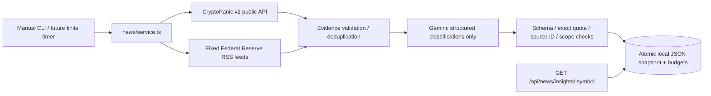

# Source-supported news intelligence

Phase 2 adds an optional component to the existing Express backend. News comes from CryptoPanic's public API and approved official RSS feeds. Gemini only classifies supplied excerpts. There is no Google Search Grounding, article crawling, URL Context, direct X/Twitter integration, ML training, forecast activation or additional API backend.

## Boundaries and contracts



`sources.ts` owns bounded fixed-origin HTTP access. `evidence.ts` parses API/RSS metadata, validates timestamps/links and deduplicates articles. `provider.ts` isolates the official SDK. `analysis.ts` validates classifications and derives a concise outlook. `store.ts` owns durable state/locking, `service.ts` orchestration/cache/budgets, and `cli.ts` finite operations. `shared/news.ts` is an additive NewsInsight contract; existing `shared/hybrid.ts`, accounting logic and disabled prediction response are unchanged.

Each event records symbol, stable ID, provider/publisher links and name, publication/observation/analysis times, category, scope, sentiment, potential impact, uncertainty, report type, evidence ID, exact excerpt and source-response SHA-256. Source validation means metadata provenance, not independent confirmation that a report is true. Aggregator reports cannot become primary statements merely because the model labels them that way. Opinion/speculation is explicitly uncertain. No calibrated probability, numerical forecast, new financial statistic or invented free-form claim is accepted from Gemini. Titles and summaries come from source excerpts; the final outlook uses a fixed template over accepted sentiments.

## Sources and usage rights

Reviewed 2026-11-06:

| Source | Access / use | Storage policy |
| --- | --- | --- |
| [CryptoPanic v2 API](https://cryptopanic.com/developers/api/) | Explicit `public=true`, `currencies=BTC,ETH`, `regions=en`, `kind=news`, page 1. API documentation permits generic public app usage and recommends local caching. Select your actual developer/growth/enterprise plan; quotas and field availability differ. | Only supplied headlines, short excerpts, source links and metadata are used. No full article, image, vote, price or proprietary panic-score archive is created. |
| [Federal Reserve RSS](https://www.federalreserve.gov/feeds/feeds.htm) | Fixed all-press and monetary-policy feeds. [Board terms](https://www.federalreserve.gov/disclaimer.htm) permit reuse of Board information unless marked otherwise and request attribution. Third-party material and logos have separate restrictions. | Retain short issuer text and links, attribute the Board, never fetch attachments or republish logos/images. |

CryptoPanic's [general terms](https://cryptopanic.com/terms/) do not establish unlimited rights in linked third-party content, an unrestricted commercial redistribution license, or a universal retention deadline. Review the account/plan contract and publisher restrictions for the intended product. Local retention defaults to 72 hours and is configurable from 24-168 hours; this is an application policy, not a claim about a provider-mandated duration. Configure a shorter period if your agreement requires it. No full-text content is requested or copied, and article URLs are never fetched. A missing original URL uses the genuine CryptoPanic item link rather than inventing a publisher URL.

The [CFTC RSS page](https://www.cftc.gov/RSS/index.htm) reports its feeds temporarily disabled as of October 2026, so they are not configured. Additional publisher feeds require a source/rights review and tests; a public RSS URL alone is not blanket redistribution permission. Source selection is intentionally limited. API/RSS data can be delayed, erroneous or incomplete; neither headlines nor sentiment prove a future price direction.

Gemini's [model documentation](https://ai.google.dev/gemini-api/docs/models/gemini-3.5-flash-lite) identifies `gemini-3.5-flash-lite` as a stable low-cost model with structured outputs. The implementation uses official `@google/genai@3.0.0`, `models.generateContent`, `responseMimeType`, `responseJsonSchema`, `abortSignal` and documented HTTP options. [Structured output support](https://ai.google.dev/gemini-api/docs/structured-output) does not prove factual validity; runtime checks still apply. Google Search-related reuse permissions and attribution widgets are unnecessary because no Search tool is invoked. Normal [Gemini terms](https://ai.google.dev/gemini-api/terms) and project/data-use settings still apply; only public, bounded excerpts are submitted, never account or portfolio data.

## Private configuration

The feature starts disabled. Existing market, health, prediction and optional mobile functionality remain available without any news credentials. All environment values are validated. `.env.example` files document values but **are not automatically loaded**.

| Variable | Default / accepted values |
| --- | --- |
| `NEWS_INTELLIGENCE_ENABLED` | `false`; explicit `true`/`false` |
| `GEMINI_API_KEY` | Private server-side key; absent means unconfigured |
| `GEMINI_KEY_ROTATED` | `false`; must be `true` after issuing a new private key |
| `GEMINI_MODEL` | `gemini-3.5-flash-lite`; configurable Gemini model ID |
| `CRYPTOPANIC_API_KEY` | Optional private API token; omit to use official RSS only |
| `CRYPTOPANIC_PLAN` | `developer`, `growth`, `enterprise`; defaults to `developer` |
| `NEWS_CACHE_TTL_SECONDS` | `21600`; range 14400-21600 (4-6 hours) |
| `NEWS_MAX_DAILY_REQUESTS` | `16`; range 1-100 Gemini HTTP attempts per UTC day |
| `NEWS_MAX_DAILY_SOURCE_REQUESTS` | `24`; range 1-200 combined API/RSS attempts per UTC day |
| `NEWS_PROVIDER_TIMEOUT_MS` | `20000`; range 1000-60000 per provider attempt |
| `NEWS_RETENTION_HOURS` | `72`; range 24-168, latest-snapshot retention from generation |
| `NEWS_STORAGE_PATH` | Absolute default: `backend/.news-data`; choose a private writable local persistent directory |

Use [Google AI Studio key management](https://ai.google.dev/gemini-api/docs/api-key) to create a **new** private key in the intended project and configure current API restrictions/key type and billing. Revoke exposed legacy credentials described in [SECURITY.md](SECURITY.md); do not reuse or retrieve them from Git history. `GEMINI_KEY_ROTATED=true` is an operator acknowledgement, not proof of issuance or a remote rotation operation. Obtain CryptoPanic credentials and the matching plan through its developer account. Keep both secrets out of `VITE_*`, `EXPO_PUBLIC_*`, Git, images, browser/mobile bundles, source URLs and logs.

## Windows / PowerShell workflow

From the repository root, install dependencies and build once:

```powershell
npm ci
npm run build
```

Supply secrets through the backend's private process environment or secret manager. For a local interactive Gemini key without echoing it or placing it in command history:

```powershell
$privateKey = Read-Host 'New private Gemini API key' -AsSecureString
$keyPointer = [Runtime.InteropServices.Marshal]::SecureStringToBSTR($privateKey)
try { $env:GEMINI_API_KEY = [Runtime.InteropServices.Marshal]::PtrToStringBSTR($keyPointer) }
finally { [Runtime.InteropServices.Marshal]::ZeroFreeBSTR($keyPointer) }
$env:GEMINI_KEY_ROTATED = 'true'
$env:NEWS_INTELLIGENCE_ENABLED = 'true'
$env:NEWS_STORAGE_PATH = Join-Path $env:LOCALAPPDATA 'Investing-Hub\news'
# Optionally supply CRYPTOPANIC_API_KEY privately and set its actual plan.
# Use the same NEWS_STORAGE_PATH/environment for API and refresh processes.
npm run news:refresh -w backend
npm run news:status -w backend
npm run news:prune -w backend
npm start -w backend
```

`refresh` is a finite job: collect up to two fixed RSS feeds and one CryptoPanic page, validate/deduplicate, analyze at most eight current evidence items, atomically publish both coin snapshots, then exit. Valid but insufficient evidence produces an explicit unknown outlook. The model can reject mere mentions or uncertain relevance. `status` prints availability, budget/cooldown/failure counters and snapshot timestamps/counts; it does not expose keys or raw source payloads. `prune` physically removes expired snapshots, works without a Gemini key, and makes no network request. Exit `0` means success/cache reuse; exit `1` means a sanitized configuration, provider, budget, lock, validation or storage failure.

Compiled production equivalents, using the same environment:

```powershell
node backend/dist/news/cli.js refresh
node backend/dist/news/cli.js status
node backend/dist/news/cli.js prune
```

No demo/mock news is ever substituted by a production path. This checkout has no private Gemini or CryptoPanic process key; a successful live Gemini/CryptoPanic integration is not claimed.

## Public API

`GET /api/news/insights/BTCUSDT` and `GET /api/news/insights/ETHUSDT` return HTTP 200 with explicit cache state. Unsupported symbols or unexpected queries return 400; POST/refresh operations are absent. Existing Helmet, CORS, global rate limiting and sanitized errors apply. GET does not instantiate the SDK, fetch sources, refresh, modify storage or start ML training.

Example with the default disabled configuration (not mock market news):

```json
{
  "symbol": "BTCUSDT",
  "status": "unavailable",
  "freshness": "unavailable",
  "lastUpdatedAt": null,
  "lastCheckedAt": null,
  "expiresAt": null,
  "reason": "disabled",
  "data": null
}
```

Other unavailability reasons include `unconfigured`, `no_snapshot`, `storage_unavailable` and `retention_expired`. Valid snapshots expose `available` or `insufficient_evidence`; TTL expiry exposes `stale` with the previous result and timestamps until retention expiry. `data` contains source-attributed events, model, fingerprint, summary, limitations and provider attribution. `lastUpdatedAt` is analysis generation time; `lastCheckedAt` can advance after unchanged evidence is revalidated without another Gemini call. Freshness is polling/cache freshness, not a comprehensive real-time news guarantee.

## Validation, cost and failure behavior

API/RSS records supply all links and publication times. No model-supplied URL is accepted, and `created_at`/observation time never fills a missing publication date. Timestamps must include a timezone and be valid, not future-dated, and within 72 hours. API originals must match their source domain; official feed links must belong to the issuer. Unsafe URL schemes, credentials, IP literals and internal domains are rejected for display. Network access accepts only the exact feeds and configured CryptoPanic v2 endpoint: article links and returned pagination URLs are never fetched. Requests refuse redirects and cap payloads at 1 MiB. XML DTDs/entities are rejected and entity expansion is disabled.

Canonical URLs, normalized content and conservative headline/summary comparison deduplicate repeated/syndicated material. Exact quote checks and enum-only output validation limit source confusion. Source instructions are treated as untrusted data: recognizable injection is rejected, prompts separate source data from instructions, Gemini has no tools, and its output cannot choose network destinations, file paths, secrets or prices. These controls reduce risk but do not establish perfect semantic accuracy or detect every adversarial instruction. Operator review and uncertainty remain necessary.

Every actual provider attempt reserves its separate daily budget **before** sending, including retries; crashes/timeouts do not refund possibly billed calls. Transient HTTP failures use at most two exponential-backoff retries. Source 403/429 and Gemini 429 stop immediate retries and persist cooldowns; known Retry-After is honored, with a conservative Gemini fallback. Source and model budgets survive normal restarts. A cache hit calls neither source nor model. After expiry, unchanged evidence skips Gemini. There is no Search query bill.

SDK token usage is recorded when supplied, including thinking tokens; up to 31 completed UTC-day usage summaries are retained in addition to the current day. The pinned default's gross text-token estimate uses the [reviewed pricing](https://ai.google.dev/gemini-api/docs/pricing): $0.30/M input and $2.50/M output tokens. No free-tier/tier/cache discount is assumed; custom models, missing usage and failed attempts remain explicitly unknown-cost requests. This is not an invoice or an enforced monetary spending cap. Review provider project caps, plan/monthly quotas and prices before production use.

Only latest snapshots, source metadata/excerpts, counters and sanitized diagnostics are persisted. Full API/RSS bodies, article contents and secrets are not retained. Both coin snapshots publish together using validated JSON, an integrity checksum, file sync and same-directory rename. A failed validation/write retains the previous file. Configured-source outages preserve an existing valid snapshot; an initial partial-source result carries an incomplete-coverage limitation. Gemini failures preserve previous results. Stale data is visible rather than labeled current.

## Persistence, recovery and future scheduling

Use a single host and local persistent disk outside OneDrive/network shares. API and workers must share one `NEWS_STORAGE_PATH`; an ephemeral/recreated container loses snapshots, budget history and cooldowns. Its unprivileged user also needs an explicitly owned writable volume. Container scaling/distributed/network-filesystem locking is outside this version. Local checksums detect accidental edits, not a malicious operator rewriting both values and hashes. Back up state only when workers are idle, keep private retention-aware backups and validate before restoring. Restoring an old budget file can undo reservations; coordinate restore with project-side spending limits.

An atomic directory lock prevents overlapping jobs across processes; a process-local guard also rejects overlap. `refresh.lock/owner.json` identifies PID, host and start time. The lock is not automatically stolen from a slow/hung worker. If a worker is forcibly killed, verify the recorded local process is no longer running, stop competing jobs, then remove only that configured directory's `refresh.lock` and retry. Incomplete `.tmp` files contain private cached state and can be removed while workers are stopped; they are never treated as published state. This conservative recovery avoids accidentally running two billed refreshes.

Future scheduling should run one finite refresh every 4-6 hours and a separate prune at least daily, even while news is disabled/unconfigured. Prune is required for physical retention cleanup when there are no successful refreshes; GET only hides expired results. Use absolute compiled CLI paths, the same private environment/storage, non-overlap, captured exit codes and alerts. On Windows Task Scheduler configure `node.exe <absolute-repo>\backend\dist\news\cli.js refresh` and a second `... prune` action under the appropriate account. A systemd timer/cron can run the same commands on a persistent single host. No timer, scheduled job, deployment or continuous polling process was registered here.

The existing web/mobile screens do not consume this optional endpoint yet. Future hybrid composition should join validated ML output with these source-referenced events, preserving provenance and the distinction between news sentiment and numeric inference. No approved numerical ML model is exposed by this feature.

See [actual verification, changed files and suggested commit groups](NEWS_VERIFICATION.md).
