# Direction and volatility forecasts

**Historical Phase 2 activation policy.** Local execution now uses the experimental
development-ranking policy in [Windows operations](LOCAL_WINDOWS.md). The future
confirmation/statistical gates below remain research diagnostics, not prerequisites
for displaying a local experimental model. Historical evidence is preserved.

This is the objective-first extension of PR #9's existing multi-horizon system.
The original price-regression study, daily SQLite lifecycle and v1/v2 APIs remain
intact. No historical research result is sufficient for activation. The reserved
future confirmation period is 2026-12-01 through 2027-02-28 UTC.

```mermaid
flowchart LR
  CSV[Verified original minute data / local Parquet] --> Existing[Existing data and feature modules]
  Existing --> Rich[Past-only multi-scale and aligned peer features]
  Rich --> Direction[Direction classifiers]
  Rich --> Volatility[Realized variance models]
  Direction --> Cal[Separate chronological calibration]
  Volatility --> Cal
  Cal --> WF[Purged walk-forward development evaluation]
  WF --> Evidence[Independent objective decisions and evidence]
  Evidence --> Future[Required frozen future confirmation]
  Future --> Registry[Checksum-checked objective registry]
  Binance[Completed Binance minutes] --> Worker[Existing bounded frozen worker]
  Registry --> Worker
  Worker --> V3[Atomic v3 objective publication / read-only API]
  V3 --> Panel[Existing coin chart ForecastPanel]
  V2[Retained v2 experimental price API] --> Optional[Expandable price research]
  Optional --> Panel
```



## Targets and features

For a completed minute origin `t` and horizon `h`, direction uses
`log(close[t+h]/close[t])`. Binary research excludes exactly zero returns for all
compared candidates and is conditional on a nonzero move. Primary three-class
research uses thresholds `±max(0.0001, 0.5*past_60m_sigma*sqrt(h))`, available at
the origin. Costs are assessed separately; a neutral/noise zone is not a claim
that a directional movement is economically tradable.

Realized variance is `sum(log(close[j]/close[j-1])**2, j=t+1..t+h)`. The displayed
volatility is its square root: nonannualized horizon log-return standard deviation.
For example, `0.004` displays as `0.4%` horizon volatility. It is neither a
future price, probability of a rise/loss, nor a guaranteed price range.

Research reuses the original finite feature pipeline and adds 2/4/8-hour momentum,
volatility-normalized returns, 5/15/60/240/1440-minute realized variance, relative
volume/quote/trade intensity, taker imbalance at several scales, wick/close position,
trend efficiency and BTC/ETH returns lagged a full minute. Exact timestamp joins
reject future/asof alignment. Self-peer inputs are neutralized to avoid redundant
self-asset copies. A bounded 1,536-minute input tail reproduces these features.
The separate feature version prevents these models entering the old price registry.

## Evaluation, calibration and selection

The committed [protocol](../ml/multihorizon/objective_study.json) fixes 32
configurations per pair: 12 direction configurations/label variants, seven direction
group ablations, five fitted volatility configurations and eight volatility Ridge
references/ablations. Nine direction hyperparameter bundles cover Logistic
Regression, Random Forest, LightGBM, XGBoost and LSTM. Binary exploration is limited
to three fixed controls; all five families are compared on the neutral objective.

Three explicit development folds use a separate preceding 14-day calibration
window, horizon purging, a one-minute embargo and train-only preprocessing.
Validation origins do not overlap within a horizon. Candidate/baseline timestamps
match; baselines use a common fixed training window and are selected using only
calibration data. Log loss, multiclass Brier sum, balanced accuracy, MCC, class
counts/reliability and cost diagnostics accompany direction. Majority accuracy
alone cannot establish a useful classifier. A larger fit sample does not guarantee
better performance; fixed 12k/36k controls and regularization variants measure it.

Direction temperature scaling is fitted only on the calibration segment. Reports
include raw/calibrated scores, maximum classwise ten-bin ECE and reliability curves.
No uncalibrated classifier output is displayed as a forecast probability. Volatility
compares unconditional mean, rolling, finite EWMA, log HAR-RV Ridge, GARCH(1,1),
LightGBM and XGBoost. Log-variance models use a fit-only residual smearing correction.
QLIKE is `log(predictedVariance)+actualVariance/predictedVariance`; zero actual
variance is valid, while zero forecast variance is rejected. Differences in QLIKE
are meaningful; a percentage of a negative absolute QLIKE is not used.

A 90% split-conformal log-volatility residual interval uses only the prior
calibration segment. Report actual validation coverage and width. Serial dependence
and drift prevent an iid finite-sample coverage guarantee. Only an interval with
measured quality can appear in live output. Historical movement categories use
training-only volatility quantiles and do not imply financial safety.

Development gates require at least 1% proper-loss/MAE advantage over the strong
calibration-selected baseline, wins in every fold, acceptable measured calibration,
and a positive multiplicity-adjusted dependent-loss bound. Volatility additionally
needs improved QLIKE. Direction and volatility are ranked independently. The family
size includes all 768 planned configurations and 144 prior model comparisons.
Seven-day bootstrap intervals are descriptive; HAC/Student-t bounds with effective
weekly degrees of freedom and Bonferroni correction remain approximate. These
limits and already-inspected history preclude treating development eligibility as
production acceptance.

Only a separately evaluated artifact frozen before 2026-12-01 can later be
confirmed on the reserved future period. Registry and HTTP readers reject premature
confirmation. Passing development checks never switches the worker on. GARCH's
historical filter can be evaluated causally, but it needs a validated bounded live
state recovery path before being a production candidate.

Development evaluation is thinned to bound CPU use; its fixed origin grid does
not establish performance at every rolling minute. Future confirmation must cover
all 60 UTC minute phases (at least 100 scored origins per phase), use overlap-aware
uncertainty and retain weekly blocks. The registry checks that declaration before
admission. Current saved artifacts are last-development-fold fits; they are not
refits on October data. Any later refit changes the artifact checksum and needs its
own pre-December freeze and future confirmation.

## Strict v3 API and live behavior

`GET /api/v3/forecasts/:symbol?horizon=1m` returns
`forecast-objectives-v3`. Allowed symbols are the existing eight coins. Horizons
are case-sensitive `1m`, `15m`, `1h`, `1M`. Unknown parameters return 400. `1M`
always returns unavailable until independent monthly evidence is adequate.

The canonical contract is [`shared/objectives.ts`](../shared/objectives.ts).
Each response includes `direction` and `volatility` independently. Each objective
has status, stable reason, generation time, model identity and optional historical
evaluation. An unavailable objective has null numeric outputs and no live model.
Development metrics are explicitly tagged and cannot substitute for forecasts.

Direction adds calibrated down/neutral/up probabilities summing to one and a
consistent label. Volatility adds a positive horizon standard deviation, historical
movement category, fixed units and an optional validated interval. Source-candle,
market-retrieval, target and explicit expiration times belong to the bundle;
generation times also remain distinct per objective. Cache hits preserve original
objective generation times. Expiration is the earlier of target time and source
close plus 90 seconds. HTTP reevaluates freshness on every read; the UI also expires
values every second. A registry/provider/model failure never substitutes a baseline.

The existing minute worker/provider is reused, with a separate checksum-protected
v3 publication and independent objective cache. Completed minute input is bounded
to 1,536 candles and at most two Binance pages. Same-origin retrievals are deduplicated
across objectives, horizons and peers. Provider timeouts, retry/cooldown, source
continuity and completion checks remain mandatory. No fitting occurs in HTTP or
on price updates. NumPy numeric artifacts reuse the old portable tree/LSTM kernel;
GARCH fitting and additional research dependencies are not added to Docker.

Both `ML_MINUTE_ENABLED` and `ML_OBJECTIVES_ENABLED` default false. There was no
Railway environment update, model deletion, automatic merge or deployment.

## Reproduce from repository root

Original CSVs and validated Parquet partitions must exist locally. Missing data
stops research; remote CI uses explicitly synthetic fixtures only for software
tests and does not pretend to reproduce the real-data study.

```powershell
.\.venv\Scripts\python.exe -m pip install -r ml/requirements-objectives.txt
$env:OMP_NUM_THREADS='1'
$env:OPENBLAS_NUM_THREADS='1'
$env:MKL_NUM_THREADS='1'
.\.venv\Scripts\python.exe ml/forecast_v2.py normalize
.\.venv\Scripts\python.exe ml/forecast_v2.py objective-research --output ml/artifacts/objectives-study-2026-11-16
.\.venv\Scripts\python.exe ml/forecast_v2.py objective-report --explain
.\.venv\Scripts\python.exe ml/forecast_v2.py objective-catalog
# Explicit local publication only. This does not activate any unconfirmed candidate:
.\.venv\Scripts\python.exe ml/forecast_v2.py worker --once --objective-registry ml/artifacts/objective-registry/registry.json
npm run dev
```

Optional standalone reliability figures use
`pip install -r ml/requirements-reports.txt` and
`python ml/forecast_v2.py objective-report --plots`. They show measured development
class frequencies, include sample-count limits, and explicitly state that future
confirmation is pending. Plotting dependencies are not added to production.

Use `--symbol BTCUSDT --horizon 15m` for a single registered pair. Fits are capped,
one numerical thread and one pair/process run at a time; pair memory/time and total
time limits are enforced. Partial/failed trials are saved and remain in evidence.
Unchanged completed runs can be resumed. A changed research source must use a new
output directory, preserving existing experiments. Raw data, model weights,
publications and local execution logs stay ignored. Only reviewable research
evidence is committed.

The unified panel offers direction/volatility switching without leaving the chart,
shows separate unavailable states and optional historical quality, and keeps price
projection collapsed with an explicit research disclosure. English/Turkish copy,
dark/light themes, small screens, expiry, and independent objective states have
dedicated browser tests. Calibration/interval screenshots use future-dated synthetic
fixtures; they are UI evidence, not successful real forecasts.

Primary references: [calibration and proper scores](https://scikit-learn.org/stable/modules/calibration.html),
[permutation importance and correlated features](https://scikit-learn.org/stable/modules/permutation_importance.html),
[GARCH analytical recursion](https://arch.readthedocs.io/en/latest/univariate/forecasting.html).
